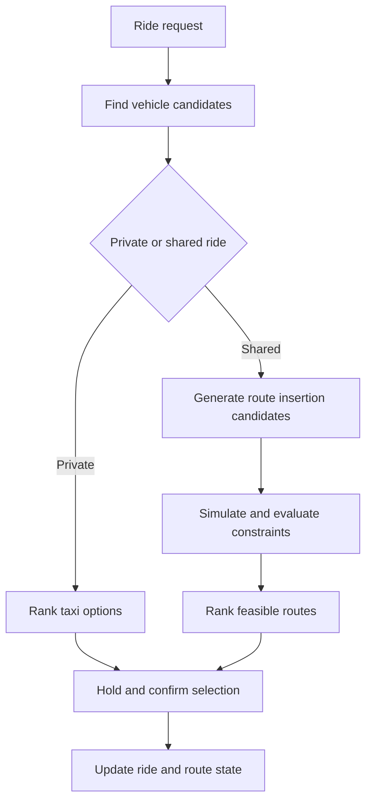

# Constraint-Based Dynamic Shared-Ride Taxi Allocation

A Django-based taxi allocation system for private and shared rides. It models a road network, generates feasible vehicle and route options, manages reservation holds, and handles recovery when an assigned vehicle becomes unavailable.

## Highlights

- Private taxi ranking by pickup ETA, pickup distance and vehicle ID.
- Travel-time-weighted shortest-path routing using a priority queue.
- Shared-ride route insertion: generate candidate pickup/drop-off sequences, simulate each route, reject infeasible candidates, and rank feasible alternatives.
- Passenger constraints covering pickup wait and absolute/relative delays, alongside route and vehicle capacity considerations.
- Temporary taxi holds with expiry and transactional database locking.
- Ride lifecycle, fleet management, pricing, tracking and notifications.
- Recovery planning and transactional reassignment for driver rejection or vehicle unavailability.
- Automated test suite covering assignment, holds, shared rides, recovery and performance scenarios.

## Architecture

| Module | Responsibility |
| --- | --- |
| `accounts` | User and driver accounts, permissions and availability |
| `fleet` | Vehicles and movement |
| `road_network` | Graph-based routing and travel metrics |
| `rides` | Ride requests, lifecycle and tracking |
| `assignment` | Taxi selection, ranking, holds and confirmation |
| `shared_ride` | Route insertion, simulation, feasibility and ranking |
| `pricing` | Fare calculation |
| `recovery` | Failure detection, replacement planning and application |
| `notifications` | Ride-related notifications |

## Allocation workflow



## Technology

Python · Django · Django REST Framework · PostgreSQL · pytest · JavaScript

## Local setup

Create a Python virtual environment, install dependencies from `requirements.txt`, and configure a local PostgreSQL database. Copy `.env.example` to `.env`, generate a new Django secret key locally and populate the database values. Set `DJANGO_DEBUG=true` only for local development. The default configuration disables debug and limits allowed hosts. Never commit the real `.env` file.

```bash
python -m venv .venv
# Activate the virtual environment for your operating system.
python -m pip install -r requirements.txt
python manage.py migrate
python manage.py runserver
```

Use a separate development database and provide road-network and fleet data before exercising allocation workflows. Review Django's security settings before deploying.

## Testing

```bash
python -m pytest
```

Test modules cover private and shared allocation, confirmation and release of holds, ride cancellation, route recovery, and performance scenarios. This README describes the repository implementation; no independent test run or production benchmark is claimed.

## Project status

Source-code portfolio project. The implementation is documented here; deployment status and production readiness have not been established.
